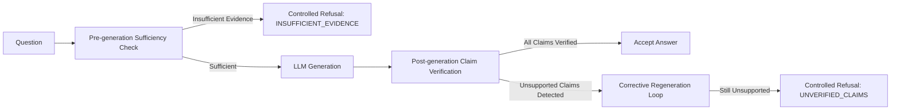

# Architectural Decision Records (ADRs)

> **AI Knowledge System**  
> Key architectural decisions, trade-offs, rationale, and consequences guiding the design and production hardening of the enterprise knowledge assistant.

---

## Index of Architectural Decisions

- [ADR-001: PostgreSQL with pgvector and HNSW Indexing](#adr-001-postgresql-with-pgvector-and-hnsw-indexing)
- [ADR-002: Multi-Stage Reliability Pipeline with Explicit Gating](#adr-002-multi-stage-reliability-pipeline-with-explicit-gating)
- [ADR-003: Deterministic Contradiction and Version Governance](#adr-003-deterministic-contradiction-and-version-governance)
- [ADR-004: Objective Ragas-Aligned Offline Benchmarking](#adr-004-objective-ragas-aligned-offline-benchmarking)
- [ADR-005: Distributed Correlation IDs and Non-Blocking Audit Tracing](#adr-005-distributed-correlation-ids-and-non-blocking-audit-tracing)
- [ADR-006: Defense-in-Depth Security and Input Sanitization](#adr-006-defense-in-depth-security-and-input-sanitization)

---

## ADR-001: PostgreSQL with pgvector and HNSW Indexing

### Status
Accepted

### Context
Enterprise systems require storing relational metadata (documents, lifecycle statuses, effective dates, checksums, audit traces) alongside high-dimensional dense vector embeddings. Adopting a dedicated vector database (e.g. Pinecone, Qdrant, Milvus) introduces distributed data synchronization complexities, two-phase commits, multiple points of failure, and higher infrastructure operational overhead.

### Decision
We use **PostgreSQL 16** with the **`pgvector`** extension and Hierarchical Navigable Small World (**HNSW**) vector indexing utilizing cosine distance operator (`vector_cosine_ops`).

### Consequences & Tradeoffs
- **Advantages**:
  - Unified ACID transactions across document metadata, chunks, embeddings, and query traces.
  - Relational filtering (`status = 'ACTIVE'`, `effective_date <= CURRENT_DATE`) executes directly within the SQL query before or during index scan.
  - Simplified single-container local and production deployment via standard PostgreSQL tools and backup workflows (`pg_dump`).
- **Tradeoffs**:
  - Higher memory footprint than specialized in-memory vector indexes at massive scale (> 100M vectors). For enterprise intranets (up to millions of chunks), HNSW indexing provides sub-5ms query response.

---

## ADR-002: Multi-Stage Reliability Pipeline with Explicit Gating

### Status
Accepted

### Context
Standard RAG architectures blindly follow `Question -> Retrieval -> LLM -> Answer`. When retrieved evidence is irrelevant or nonexistent, the LLM generates plausible-sounding but completely fabricated hallucinations. Furthermore, language models extrapolate beyond given facts even when relevant documents are supplied.

### Decision
We implement a **9-stage verified reliability pipeline** with explicit pre-generation gating, post-generation faithfulness verification, corrective regeneration, and controlled refusal behavior:

### Consequences & Tradeoffs
- **Advantages**:
  - Zero tolerance for plausible fabrications.
  - Queries lacking supporting evidence are halted before LLM execution, saving GPU/API inference costs.
  - Audited mathematical faithfulness score ($0.0 - 1.0$) returned with every published response.
- **Tradeoffs**:
  - Additional latency overhead (~20-50ms) for deterministic claim decomposition and entity matching. This is an intentional design choice prioritizing correctness over raw throughput.

---

## ADR-003: Deterministic Contradiction and Version Governance

### Status
Accepted

### Context
Enterprise repositories frequently contain conflicting policies across departments (e.g. Engineering handbook stating 25 vacation days vs. Corporate policy stating 20 days) or across document versions (superseded 2024 policy vs. active 2026 policy). LLMs cannot reliably resolve policy seniority without deterministic rules and often synthesize contradictory facts into confusing answers.

### Decision
We implement **deterministic rule-based contradiction analysis and lifecycle resolution** in `ContradictionService`:
1. Chunks are extracted into factual claims and audited for numeric discrepancies, polarity mismatches, and schedule divergences.
2. If conflicts exist, resolution adheres to strict corporate governance:
   - `ACTIVE` documents supersede `SUPERSEDED` and `EXPIRED` documents.
   - Currently effective documents supersede past or pending documents.
   - Higher version numbers supersede lower version numbers.
3. If two conflicting documents have identical lifecycle status (e.g. two conflicting `ACTIVE` policies), the system strictly refuses to answer with `CONFLICTING_EVIDENCE` and surfaces both sources transparently.

### Consequences & Tradeoffs
- **Advantages**:
  - Completely predictable, auditable policy resolution.
  - Immunizes the system against vector traps where an outdated document matches with higher cosine similarity than an active policy.
- **Tradeoffs**:
  - Requires document ingestion to capture version and lifecycle metadata.

---

## ADR-004: Objective Ragas-Aligned Offline Benchmarking

### Status
Accepted

### Context
Evaluating RAG systems via ad-hoc manual testing or "vibes" provides no reproducible quality guarantees and fails to prevent silent regressions during prompt or retrieval parameter tuning.

### Decision
We implement an objective automated evaluation harness in `evaluation/`:
- Test scenarios span 6 distinct query archetypes: straightforward, multi-document synthesis, unsupported out-of-domain questions, ambiguous queries, versioned documents, and direct contradiction cases.
- Computes 4 core RAG metrics:
  - **Faithfulness**: Fraction of factual claims grounded in context.
  - **Answer Relevancy**: Semantic alignment between generated answer and original question.
  - **Context Precision@K**: Ranking accuracy placing relevant chunks at top retrieval ranks.
  - **Context Recall**: Retrieval coverage of ground truth reference facts.
- Includes automated A/B experiment comparison tool (`python -m evaluation.run`) producing diff reports.

### Consequences & Tradeoffs
- **Advantages**:
  - Quantitative metrics tracked over time in CI/CD and visible in the Admin Dashboard.
  - Enables data-driven tuning of chunk sizes, retrieval thresholds, and prompts.
- **Tradeoffs**:
  - Requires maintaining a curated evaluation dataset (`benchmark_dataset.json`).

---

## ADR-005: Distributed Correlation IDs and Non-Blocking Audit Tracing

### Status
Accepted

### Context
Debugging production queries across multi-stage pipelines requires tracking the complete lifecycle from request ingestion to final output. However, audit logging must never degrade user-facing question-answering latency or cause user requests to fail if logging storage experiences a transient hiccup.

### Decision
1. `RequestContextMiddleware` generates or propagates an `X-Request-ID` UUID across HTTP request/response headers.
2. The ID is passed through all pipeline stages and bound to a dedicated `QueryTraceModel` database record.
3. Trace persistence in `RAGService._save_trace` is wrapped in an isolated exception-safe block, ensuring that any telemetry persistence anomaly never interrupts customer query delivery.

### Consequences & Tradeoffs
- **Advantages**:
  - Every answer returned to users is 100% traceable to its retrieval chunks, sufficiency check, verification score, and latency.
  - Support staff can look up any `request_id` in the Admin Dashboard (`/dashboard`) to view the exact step-by-step diagnostic trace.
- **Tradeoffs**:
  - Minimal database write overhead per query (~2-4ms).

---

## ADR-006: Defense-in-Depth Security and Input Sanitization

### Status
Accepted

### Context
Enterprise knowledge assistants are exposed to untrusted user input and document uploads, making them vulnerable to path traversal attacks, malicious binary uploads disguised as text, and prompt injection attempts designed to extract internal system prompts.

### Decision
We enforce multi-layer defense in `app/core/security.py`:
1. **Prompt Injection Defense**: Regex scanning for instruction overrides (`ignore previous instructions`), jailbreak persona switches (`you are now DAN`), and system prompt extraction patterns before retrieval or LLM execution.
2. **Path Traversal Sanitization**: All uploaded filenames are stripped of directory traversal sequences (`../`, `..\`) and control characters via `sanitize_filename`.
3. **Magic Byte Verification**: `validate_file_magic` verifies binary file signatures (`%PDF-`, `PK\x03\x04`) and guards against binary executables disguised as plain text.
4. **Log Masking**: `mask_sensitive_data` automatically redacts API keys, Bearer tokens, passwords, and secrets from all console and JSON log records.

### Consequences & Tradeoffs
- **Advantages**:
  - Safe operation in zero-trust corporate intranet environments.
  - Injection attempts are rejected immediately at HTTP status 422 with zero LLM token consumption.
- **Tradeoffs**:
  - Pattern-based injection defense protects against obvious attacks but should be paired with external API gateways or model-based guardrails for adversarial edge cases.
