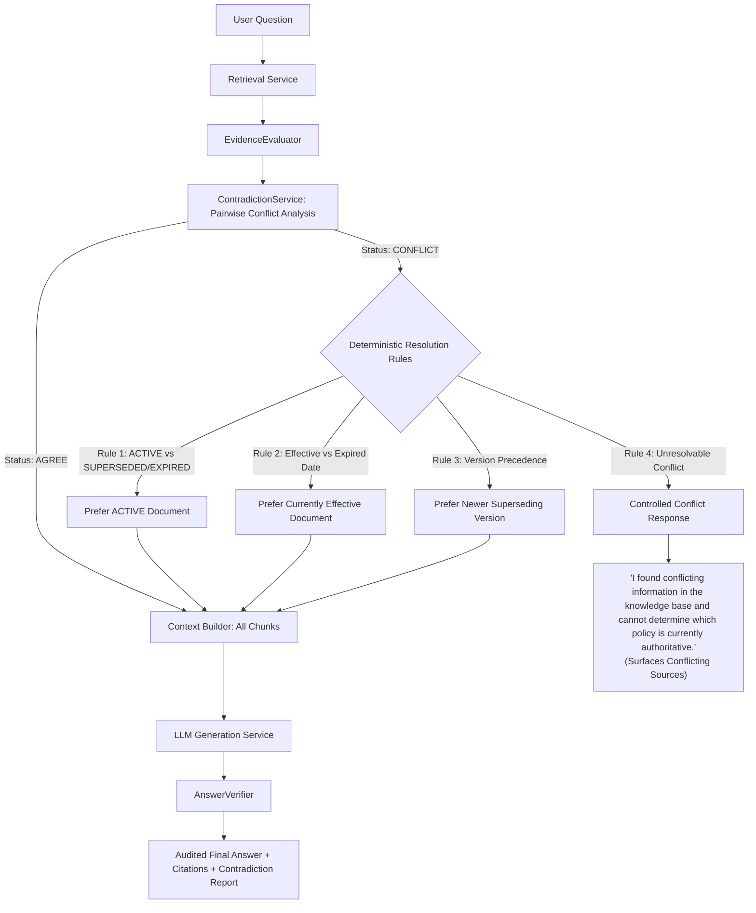

# Contradictory Knowledge & Document Version Handling

## Overview

Enterprise knowledge bases routinely accumulate historical policies, regional amendments, and superseded standard operating procedures. A naive RAG system will retrieve chunks based purely on dense semantic vector similarity, heedlessly blending incompatible rules or silently choosing whichever document happens to have higher keyword density or vector cosine score.

The **AI Knowledge System** prevents this failure mode through an explicit **Contradiction Analysis & Document Version Handling Engine**.

---

## Architecture Flow



---

## 1. Contradiction Detection Engine

The `ContradictionService` performs cross-document factual analysis across retrieved chunks.

### Conflict Categorization:
- **`AGREE`**: Retrieved chunks convey matching facts without contradiction, or address disjoint non-competing clauses.
- **`PARTIALLY_CONFLICT`**: Chunks share topic domains but contain differing qualifications or minor variations.
- **`CONFLICT`**: Chunks make diametrically opposed assertions or assert contradictory metrics about the exact same policy attribute.

### Detection Mechanisms:
1. **Topic Alignment**: Extracts non-stopword domain entities and determines whether two sentences from different sources discuss the same subject.
2. **Quantitative & Numeric Discrepancy**: Detects disjoint number sets for the same metric:
   - *Source A*: `"Employees receive 20 annual vacation days upon hiring."`
   - *Source B*: `"Employees receive 25 annual vacation days upon hiring."`
   - Outcome: Flagged as `numeric_discrepancy` on topic `"annual days employees vacation"`.
3. **Polarity & Antonym Mismatches**: Checks for opposition between permissive indicators (`permitted`, `allowed`, `mandatory`) and restrictive indicators (`prohibited`, `forbidden`, `disallowed`):
   - *Source A*: `"Production deployments are permitted on Fridays."`
   - *Source B*: `"Production deployments are strictly prohibited on Fridays."`
   - Outcome: Flagged as `polarity_mismatch`.
4. **Schedule & Calendar Divergences**: Detects disjoint days-of-the-week or conflicting working schedules for the same operational process.

---

## 2. Document Versioning Model

Documents carry explicit lifecycle metadata:
- **`version`**: Semantic or chronological version string (e.g., `"1.0"`, `"2.0"`, `"2024.1"`, `"2026.1"`).
- **`status`**: Current corporate authority:
  - `ACTIVE`: Authoritative corporate policy currently in effect.
  - `SUPERSEDED`: Replaced by a newer version. Kept for historical auditability and compliance.
  - `EXPIRED`: No longer valid due to passing its expiration date.
- **`effective_date`**: Date upon which policy rules become legally or operationally active.
- **`expiration_date`**: Date upon which policy rules lapse.

---

## 3. Deterministic Conflict Resolution Rules

When a direct contradiction is detected between two or more documents, the engine evaluates deterministic rules in strict order:

### Rule 1: Status Precedence (`ACTIVE` > `SUPERSEDED` / `EXPIRED`)
If one conflicting document is `ACTIVE` and the other is `SUPERSEDED` or `EXPIRED`:
- The `ACTIVE` document prevails.
- Chunks from the non-active document are discarded from context construction.
- Resolution code: `RESOLVED_BY_ACTIVE_STATUS`.

### Rule 2: Temporal Precedence (Effective Date vs Expired Date)
If evaluation date $t$ satisfies:
$$\text{effective\_date} \le t \le \text{expiration\_date}$$
for Document B, while Document A has $\text{expiration\_date} < t$:
- Document B prevails as currently effective.
- Resolution code: `RESOLVED_BY_EFFECTIVE_DATE`.

### Rule 3: Version Precedence (Newer Version Supersedes Older)
If both documents belong to the same policy lineage and one version strictly supersedes the other ($v_{\text{new}} > v_{\text{old}}$):
- The newer version prevails.
- Resolution code: `RESOLVED_BY_NEWER_VERSION`.

### Rule 4: Unresolvable Direct Conflict
If conflicting documents possess equal authority (e.g., both are `ACTIVE`, neither has an expired date, and neither version supersedes the other):
- **The system NEVER silently picks whichever document has a higher vector similarity score.**
- The system returns an explicit, controlled conflict notification:
  > `"I found conflicting information in the knowledge base and cannot determine which policy is currently authoritative."`
- The system **surfaces the conflicting sources** in the `sources` field so the user can inspect both competing policies.
- Reason code: `CONFLICTING_EVIDENCE`.

---

## 4. API Visibility Contract

When a conflict is unresolvable:
```json
{
  "question": "How many vacation days are employees entitled to annually?",
  "answer": "I found conflicting information in the knowledge base and cannot determine which policy is currently authoritative.",
  "confidence": "low",
  "confidence_score": 0.0,
  "reason": "CONFLICTING_EVIDENCE",
  "sources": [
    {
      "document": "vacation_hr.txt",
      "version": "1.0",
      "chunk_id": "a6ecb5a0-ad7e-439c-b1bc-6096406b7b57",
      "score": 0.8952,
      "excerpt": "HR Department Standard. All employees are entitled to 20 vacation days annually."
    },
    {
      "document": "vacation_eng.txt",
      "version": "1.0",
      "chunk_id": "0d6536ab-32b4-4dd5-ba1a-1ed4cee4cc2c",
      "score": 0.8555,
      "excerpt": "Engineering Department Standard. All employees are entitled to 25 vacation days annually."
    }
  ],
  "contradiction": {
    "status": "CONFLICT",
    "has_conflict": true,
    "claims": [
      "All employees are entitled to 20 vacation days annually.",
      "All employees are entitled to 25 vacation days annually."
    ],
    "conflicting_sources": [
      "vacation_hr.txt",
      "vacation_eng.txt"
    ],
    "resolution_status": "UNRESOLVED",
    "resolution_rationale": "Unresolvable direct conflict between 'vacation_hr.txt' (v1.0, ACTIVE) and 'vacation_eng.txt' (v1.0, ACTIVE) on topic 'all annually days employees'."
  }
}
```

When a conflict is deterministically resolved:
```json
{
  "question": "How many annual vacation days do employees receive?",
  "answer": "According to [Document 1], employees receive 25 annual vacation days upon hiring.",
  "confidence": "high",
  "sources": [
    {
      "document": "policy_2026.txt",
      "version": "2026.1",
      "score": 0.8935,
      "excerpt": "Corporate Vacation Policy. Employees receive 25 annual vacation days upon hiring."
    }
  ],
  "contradiction": {
    "status": "CONFLICT",
    "has_conflict": true,
    "resolution_status": "RESOLVED_BY_ACTIVE_STATUS",
    "resolution_rationale": "Resolved via ACTIVE status: 'policy_2026.txt' is ACTIVE; 'policy_2024.txt' is SUPERSEDED."
  }
}
```
