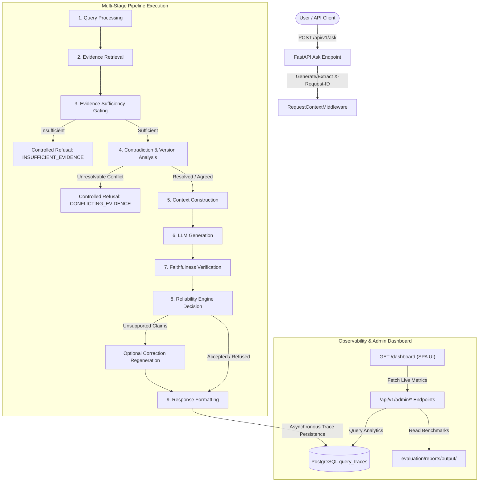

# Observability & Admin Control Plane

> **Phase 9 Architecture & Implementation Specification**  
> Comprehensive observability, distributed request correlation, pipeline telemetry, and enterprise admin dashboard for the **AI Knowledge System**.

---

## 1. Architectural Philosophy

In enterprise production deployments, an AI Knowledge System cannot be treated as an opaque black box. When an assistant refuses to answer, regenerates an answer, or flags conflicting policies, stakeholders need complete visibility into every internal decision stage.

The **AI Knowledge System Control Plane** makes the internal mechanics of the RAG pipeline observable:



---

## 2. Distributed Tracing & Correlation

Every request traversing the system is assigned a unique UUIDv4 correlation identifier (`X-Request-ID`):
1. **Middleware Propagation**: `RequestContextMiddleware` extracts existing `X-Request-ID` headers or creates a fresh UUID, attaching it to `request.state.request_id` and outgoing response headers.
2. **Context Binding**: The correlation ID is passed directly into `RAGService.answer_question(..., request_id=req_id)`.
3. **Database Audit Recording**: Upon pipeline completion or controlled exit, `_save_trace()` creates a non-blocking `QueryTraceModel` record storing:
   - Request metadata (`question`, `cleaned_query`, `top_k`, `similarity_threshold`)
   - Retrieval stats (`retrieval_count`, `top_similarity_score`, `mean_similarity_score`)
   - Pre-generation gating (`is_sufficient`, `sufficiency_reason`)
   - Contradiction status (`contradiction_status`, `resolution_action`)
   - Post-generation verification (`generated_answer`, `faithfulness_score`, `supported`, `unsupported_claims`)
   - Final diagnostic decision (`final_decision`: `ACCEPTED`, `REGENERATED`, `REFUSED`, `refusal_reason`)
   - Complete itemized source citations (`citations`)
   - Step-by-step diagnostic breakdown (`trace_details["pipeline_stages"]`)
   - Execution latency (`latency_ms`) and model name (`model_name`)

---

## 3. Database Schema

### `query_traces` Table

| Column | Type | Description |
| :--- | :--- | :--- |
| `id` | `UUID` (PK) | Unique trace record ID |
| `request_id` | `VARCHAR(100)` (Index) | Correlation UUID matching HTTP headers |
| `question` | `TEXT` | Raw user question |
| `cleaned_query` | `TEXT` | Normalized search query after preprocessing |
| `top_k` | `INTEGER` | Requested retrieval depth |
| `similarity_threshold` | `FLOAT` | Active cosine similarity cutoff |
| `retrieval_count` | `INTEGER` | Number of chunks retrieved above threshold |
| `top_similarity_score` | `FLOAT` | Highest cosine similarity among retrieved chunks |
| `mean_similarity_score` | `FLOAT` | Mean cosine similarity of retrieved evidence cluster |
| `is_sufficient` | `BOOLEAN` | Pre-generation evidence sufficiency check result |
| `sufficiency_reason` | `VARCHAR(100)` | Reason if evidence gating failed |
| `contradiction_status` | `VARCHAR(50)` | `AGREE`, `PARTIALLY_CONFLICT`, or `CONFLICT` |
| `generated_answer` | `TEXT` | Final published or refused answer text |
| `faithfulness_score` | `FLOAT` | Audited fraction ($0.0 - 1.0$) of verified claims |
| `supported` | `BOOLEAN` | `True` if all factual claims are grounded |
| `unsupported_claims` | `JSON` | List of unverified or hallucinated claims |
| `final_decision` | `VARCHAR(50)` (Index) | `ACCEPTED`, `REGENERATED`, or `REFUSED` |
| `refusal_reason` | `VARCHAR(100)` | `INSUFFICIENT_EVIDENCE`, `CONFLICTING_EVIDENCE`, `UNVERIFIED_CLAIMS` |
| `citations` | `JSON` | Itemized citation records with chunk ID and excerpts |
| `trace_details` | `JSON` | Complete multi-stage diagnostic timeline |
| `latency_ms` | `FLOAT` | Total pipeline execution time in milliseconds |
| `model_name` | `VARCHAR(100)` | Underlying LLM provider model |
| `created_at` | `TIMESTAMP` (Index) | Timestamp of trace creation |

### `system_error_logs` Table

Records uncaught exceptions or infrastructure faults with `request_id`, `endpoint`, `error_message`, and `stack_trace` for administrative inspection.

---

## 4. Admin Dashboard Sections

The dashboard is accessible at:
```
http://localhost:8001/dashboard
```

It is built as an enterprise dark-slate single-page application with responsive side navigation, real-time refresh, and zero external NPM dependencies:

### 1. Overview
- **KPI Stat Cards**: Total documents, total chunks, total queries answered, acceptance rate (%), refusal rate (%).
- **Score Gauges**: Average retrieval similarity, average faithfulness score, average answer relevancy (from latest Ragas benchmark).
- **Recent System Errors**: Live tabular audit of any backend errors or timeouts.

### 2. Query Explorer
- **Interactive Filtering**: Filter queries by decision (`ALL`, `ACCEPTED`, `REGENERATED`, `REFUSED`) or search by keyword.
- **Trace Inspector Drawer**: Clicking any query row opens a slide-over modal drawer displaying:
  - User question, answer, and latency
  - Verification audit (faithfulness score, supported status, unverified claims)
  - Itemized source citations with document names, versions, and chunk excerpts
  - Full multi-stage pipeline timeline (`query_processing` $\rightarrow$ `retrieval` $\rightarrow$ `evidence_sufficiency` $\rightarrow$ `contradiction_and_versioning` $\rightarrow$ `context_construction` $\rightarrow$ `initial_generation` $\rightarrow$ `faithfulness_verification` $\rightarrow$ `reliability_decision` $\rightarrow$ `response_formatting`).
- **Interactive Live Tester**: Submit queries directly from the UI and observe traces generated in real time.

### 3. Retrieval Analysis
- **Score Distribution Histogram**: Visual bar buckets (`<0.40`, `0.40-0.55`, `0.55-0.70`, `0.70-0.85`, `>0.85`).
- **Threshold Gating Effectiveness**: Current active retrieval threshold vs. default top_k.
- **Signal-to-Noise Ratio**: Relevant retrievals count vs. irrelevant/below-threshold retrievals.
- **Top Retrieved Documents Leaderboard**: Most frequently retrieved documents in knowledge queries.

### 4. Evaluation Benchmarks
- **Historical Ragas Runs**: Cards itemizing automated benchmark executions with run ID, timestamp, model, embedding model, and metric badges:
  - **Faithfulness**
  - **Context Precision**
  - **Context Recall**
  - **Answer Relevancy**
- **Comparative Analysis**: Head-to-head comparison between configurations (e.g., `Config_A_TopK_3` vs. `Config_B_TopK_5`) showing percentage delta and performance tradeoffs.

### 5. Knowledge Base Catalog
- Comprehensive inventory table of all ingested documents:
  - Filename & title
  - Format (`pdf`, `docx`, `txt`, `md`)
  - Document version
  - Lifecycle status badge (`ACTIVE`, `SUPERSEDED`, `EXPIRED`)
  - Effective and expiration dates
  - Chunk count
  - Embedding health (`EMBEDDED` or `PENDING`)
  - SHA-256 integrity checksum

### 6. Reliability & Safety
- **Hallucinations Prevented Counter**: Total ungrounded claims intercepted by post-generation verification.
- **Ungrounded Claims Audit Log**: Detailed log of intercepted statements, associated question, and resulting decision.
- **Controlled Refusals Breakdown**: Categorized distribution of refusals (`INSUFFICIENT_EVIDENCE`, `CONFLICTING_EVIDENCE`, `UNVERIFIED_CLAIMS`).
- **Contradiction Incidents**: Log of policy discrepancy cases detected by the contradiction engine.

---

## 5. Admin REST API Reference

All endpoints are mounted under `/api/v1/admin` and return structured JSON:

| Method | Endpoint | Description |
| :--- | :--- | :--- |
| `GET` | `/api/v1/admin/overview` | Returns top-level KPIs, acceptance/refusal rates, and recent errors |
| `GET` | `/api/v1/admin/queries` | Paginated query traces with filters (`decision`, `search`, `limit`, `offset`) |
| `GET` | `/api/v1/admin/queries/{request_id}` | Full step-by-step pipeline execution trace for a single request |
| `GET` | `/api/v1/admin/retrieval` | Cosine similarity score distributions, threshold gating, and top documents |
| `GET` | `/api/v1/admin/evaluation` | Historical Ragas benchmark runs and comparative experiment reports |
| `GET` | `/api/v1/admin/knowledge-base` | Complete catalog of documents, versions, chunks, and embedding health |
| `GET` | `/api/v1/admin/reliability` | Hallucination logs, unverified claims, and refusal breakdown |
| `GET` | `/dashboard` | Serves the enterprise dark-slate single-page admin application |

---

## 6. Verification & Automated Testing

The implementation includes:
- **Unit Tests** (`tests/unit/test_admin_service.py`): Testing `AdminService` query builders, KPI aggregation, score bucketing, report loading, and error logs.
- **Integration Tests** (`tests/integration/test_admin_api.py`): Testing all 7 admin API endpoints, `404` handling, `/dashboard` HTML serving, and end-to-end trace correlation from `POST /api/v1/ask`.
- **Full Suite**: 138 automated tests passing cleanly inside Docker.
