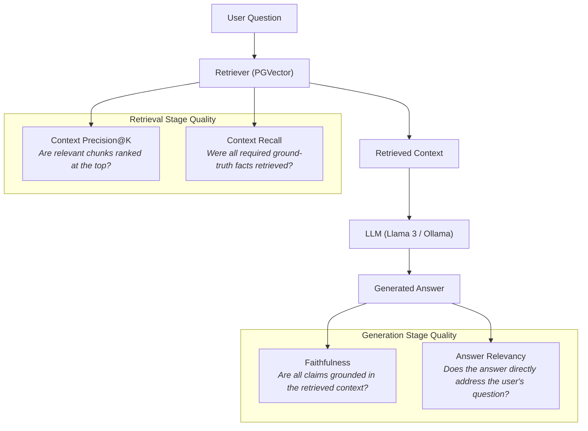

# Phase 8: Automated RAG Evaluation Architecture

## 1. Executive Overview

Rather than relying on subjective manual testing or asserting that the system "works well" based on cherry-picked examples, **Phase 8** implements an automated, reproducible, and objective evaluation framework inspired by the **Ragas** (Retrieval Augmented Generation Assessment) methodology.

The framework benchmarks the actual end-to-end application pipeline against a rigorous ground-truth dataset across diverse question archetypes, measures key retrieval and generation metrics, and generates structured comparison reports between different retrieval configurations (e.g., `top_k = 3` vs. `top_k = 5`).

---

## 2. Core Evaluation Metrics

We focus on four foundational RAG metrics that evaluate both the **retrieval stage** (Context Precision, Context Recall) and the **generation stage** (Faithfulness, Answer Relevancy).



### A. Faithfulness (Generator Quality)
- **Definition**: Measures the factual consistency of the generated answer against the retrieved context. An answer is faithful if all claims asserted in the response can be logically inferred from the retrieved chunks.
- **Mathematical Formulation**:
  $$\text{Faithfulness} = \frac{|\text{Factual claims in answer supported by context}|}{|\text{Total factual claims in answer}|}$$
- **Why it is useful**:
  Large language models frequently hallucinate facts or draw upon unverified training-data priors when company documents are silent or ambiguous. Faithfulness ensures that the assistant acts strictly as an authoritative interface to corporate knowledge, refusing to guess when evidence is absent.
- **Handling Refusals**:
  When a question is unanswerable or contradictory, and the system issues an authoritative refusal (`INSUFFICIENT_EVIDENCE` or `CONFLICTING_EVIDENCE`), faithfulness is recorded as **1.0** because the refusal accurately represents the absence of supporting evidence.

---

### B. Answer Relevancy (Generator Quality)
- **Definition**: Measures how pertinent and directly responsive the generated answer is to the user's question, penalizing rambling, evasiveness, or irrelevant boilerplate.
- **Mathematical Formulation**:
  $$\text{Answer Relevancy} = \text{cosine\_similarity}(E(q), E(a)) \times \text{completeness\_factor}$$
- **Why it is useful**:
  An answer can be 100% faithful to retrieved documents (for example, quoting a random company policy verbatim) while completely failing to address what the user actually asked. Answer relevancy isolates semantic responsiveness from factual grounding.

---

### C. Context Precision (Retriever Quality)
- **Definition**: Evaluates whether the retrieved context contains relevant information and whether the relevant chunks are prioritized at the top ranks (Mean Average Precision at $K$).
- **Mathematical Formulation**:
  $$\text{Context Precision@K} = \frac{\sum_{k=1}^K (\text{Precision@}k \times v_k)}{\text{Total number of relevant chunks in top } K}$$
  where:
  - $v_k \in \{0, 1\}$ indicates whether the chunk at rank $k$ is relevant to ground truth.
  - $\text{Precision@}k = \frac{\sum_{i=1}^k v_i}{k}$.
- **Why it is useful**:
  LLMs are vulnerable to "lost-in-the-middle" attention degradation. If a retriever places irrelevant distractor chunks at ranks 1 and 2 and buries the actual answer at rank 5, generation quality drops significantly. Context precision penalizes poor ranking.

---

### D. Context Recall (Retriever Quality)
- **Definition**: Measures the proportion of ground-truth relevant documents and facts successfully retrieved by the retrieval step.
- **Mathematical Formulation**:
  $$\text{Context Recall} = \frac{|\text{Expected ground-truth documents/facts retrieved}|}{|\text{Total expected ground-truth documents/facts}|}$$
- **Why it is useful**:
  The generator cannot synthesize what the retriever fails to provide. In multi-document questions (e.g. comparing engineering deployment rules with security credentials policy), missing one document drops recall to 0.5, inevitably leading to incomplete answers or hallucination.

---

## 3. Benchmark Dataset Taxonomy

The evaluation dataset (`evaluation/datasets/eval_dataset.json`) covers 6 critical question archetypes:

| Category | Example Question | Expected Behavior | Key Test Focus |
| :--- | :--- | :--- | :--- |
| **Straightforward** | *"How many peer approvals are required for pull requests before merging?"* | `answer_with_citations` | Single-document precision and factual citation. |
| **Multi-Document** | *"On which days are production deployments permitted, and what is the rule regarding API keys or database credentials in source code?"* | `answer_with_citations` | Cross-document retrieval recall and joint synthesis. |
| **Unsupported** | *"What is the company policy regarding bringing dogs or personal pets to the office?"* | `refuse_insufficient_evidence` | Hallucination defense; zero fabricated claims. |
| **Ambiguous** | *"Can I deploy code to production right now?"* | `answer_with_citations` | Retrieval of conditional constraints (approvals + permitted days). |
| **Document Versioning** | *"How many annual vacation days do employees receive under the current active corporate vacation policy?"* | `resolve_superseded_version` | Resolving active (2026.1) over superseded (2024.1) policy. |
| **Contradictory Knowledge** | *"What is the standard annual vacation entitlement across company departments?"* | `refuse_conflicting_evidence` | Detecting unresolvable department conflict (HR 20 days vs. Eng 25 days) and refusing to guess. |

---

## 4. Module Architecture

The evaluation harness is organized into modular packages:

```
evaluation/
├── __init__.py
├── datasets/
│   ├── __init__.py
│   ├── schemas.py         # Pydantic models (EvalExample, EvalDataset)
│   ├── loader.py          # Dataset loader and automated DB fixture seeder
│   └── eval_dataset.json  # 11 canonical benchmark scenarios
├── metrics/
│   ├── __init__.py
│   ├── base.py            # BaseMetric and MetricResult abstractions
│   ├── faithfulness.py    # Claim extraction and support verification
│   ├── answer_relevancy.py# Semantic query-answer alignment
│   ├── context_precision.py # Average Precision@K rank evaluator
│   └── context_recall.py  # Ground truth document coverage evaluator
├── runners/
│   ├── __init__.py
│   ├── evaluator.py       # EvaluationRunner executing live RAG pipeline
│   └── comparator.py      # ExperimentComparator analyzing metric deltas
├── reports/
│   ├── __init__.py
│   ├── generator.py       # Markdown executive & comparative report formatter
│   ├── store.py           # JSON and Markdown artifact persistence
│   └── output/            # Generated benchmark reports
└── run.py                 # CLI entry point (python -m evaluation.run)
```

---

## 5. Execution & Reproducibility

### Running the Evaluation CLI

To run the automated comparative experiment between **Configuration A** (`top_k=3`) and **Configuration B** (`top_k=5`):

```bash
# Inside Docker container
docker compose exec backend python -m evaluation.run

# Or locally with activated virtual environment
source .venv/bin/activate
python -m evaluation.run
```

### CLI Options

```bash
python -m evaluation.run \
    --compare \
    --config-a-name "Config_TopK_3" --top-k-a 3 \
    --config-b-name "Config_TopK_5" --top-k-b 5 \
    --similarity-threshold 0.35
```

Reports are automatically saved to `evaluation/reports/output/`:
- `eval_<timestamp>_<config_name>.json`: Complete machine-readable run results.
- `eval_<timestamp>_<config_name>.md`: Human-readable markdown audit table.
- `comparison_<config_a>_vs_<config_b>.json`: Metric deltas and shift percentages.
- `comparison_<config_a>_vs_<config_b>.md`: Comparative analysis and engineering trade-offs.
