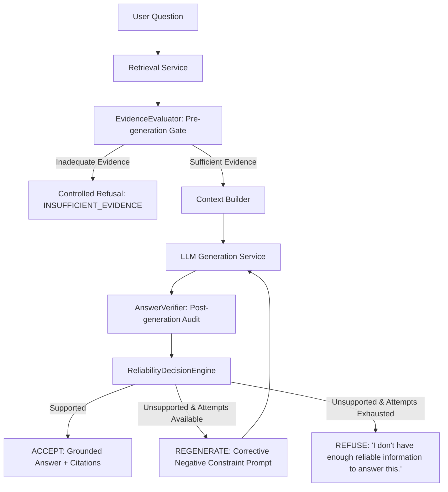

# Answer Reliability and Hallucination Detection

## Overview

In enterprise knowledge systems, a language model will often generate articulate, plausible-sounding answers even when the retrieved documentation does not support them. The **AI Knowledge System** treats hallucination detection and claim grounding as primary architectural concerns rather than post-hoc evaluation.

The system replaces the naive RAG sequence:
$$\text{Question} \longrightarrow \text{Retrieval} \longrightarrow \text{LLM} \longrightarrow \text{Answer}$$

with a multi-stage audited verification pipeline:
$$\text{Question} \longrightarrow \text{Retrieval} \longrightarrow \text{EvidenceEvaluator} \longrightarrow \text{LLM} \longrightarrow \text{AnswerVerifier} \longrightarrow \text{ReliabilityDecisionEngine} \longrightarrow \text{Final Answer}$$

---

## Architectural Stages



---

## 1. Pre-Generation Gate: `EvidenceEvaluator`

The `EvidenceEvaluator` inspects retrieved evidence before invoking the LLM. If retrieval fails quality and coverage checks, generation is blocked upfront.

### Evaluation Rules:
1. **Empty Retrieval Check**: If 0 chunks match the query, immediate short-circuit.
2. **Similarity Threshold Check**: If the top retrieved chunk score $s_1 < \tau_{\text{sim}}$ (default: $0.45$), evidence is considered too weak.
3. **Query Keyword Coverage Check**: If query topic keywords $K_Q$ are extracted and fewer than $25\%$ appear anywhere in the retrieved text corpus, the context is flagged as irrelevant or tangential.

When `EvidenceEvaluator` fails:
- **Status**: `REFUSE`
- **Answer**: `"I couldn't find sufficient information in the available knowledge base to answer this question reliably."`
- **Reason**: `INSUFFICIENT_EVIDENCE`
- **Sources**: `[]` (prevents false attribution)

---

## 2. Post-Generation Audit: `AnswerVerifier`

Once the LLM generates an answer, the `AnswerVerifier` breaks the response down into discrete assertions and audits each claim against the retrieved context.

### A. Claim Extraction
- Strips citation labels (e.g., `[Document 1]`, `[Doc: file.pdf]`, `[1]`).
- Strips conversational and epistemic framing (`"Based on the provided context..."`, `"According to..."`).
- Identifies and verifies legitimate refusal phrases (e.g., `"I don't have enough reliable information..."`) as zero-assertion valid refusals.
- Segments remaining text into candidate factual sentences.

### B. Claim Verification Mechanisms
For each extracted claim:
1. **Quantitative & Numeric Invariance**:
   Numbers, dates, and metrics in the claim are cross-referenced against the context:
   $$\text{numbers}(\text{claim}) \subseteq \text{numbers}(\text{context})$$
   If an answer asserts `"retained for 3 years"` when context states `"7 years"`, the claim is deterministically flagged as a hallucination ($score = 0.0$).
2. **Entity and Concept Recall**:
   Non-stopword content tokens ($\ge 3$ characters) are checked against sentence-level and global context token sets.
3. **Local and Global Entailment**:
   - Best sentence token overlap ratio $\ge 0.55$, OR
   - Global context token overlap ratio $\ge 0.75$.

### C. Faithfulness Score Formula
$$\text{Faithfulness Score } F = \frac{|\text{verified grounded claims}|}{|\text{total claims asserted}|} \in [0.0, 1.0]$$

An answer is considered `supported` if and only if:
$$F \ge \tau_{\text{faithfulness}} \quad (\text{default: } 0.80)$$

---

## 3. Decision & Recovery: `ReliabilityDecisionEngine`

The `ReliabilityDecisionEngine` enforces corporate governance rules and chooses between three operational actions:

| Action | Condition | Operational Behavior |
|---|---|---|
| **`ACCEPT`** | $F \ge \tau_{\text{faithfulness}}$ | Publishes synthesized answer, verified source citations, and reliability audit report. |
| **`REGENERATE`** | $F < \tau_{\text{faithfulness}}$ and $\text{attempt} < \text{max\_attempts}$ | Generates a corrective retry prompt explicitly listing the unverified claims as negative constraints. |
| **`REFUSE`** | $F < \tau_{\text{faithfulness}}$ and $\text{attempt} \ge \text{max\_attempts}$ | Refuses answer publication. Replaces answer with: `"I don't have enough reliable information to answer this."`, sets `reason: "UNVERIFIED_CLAIMS"`, and clears source citations. |

### Corrective Regeneration Prompt
When `REGENERATE` triggers, the engine injects explicit negative boundaries:
```
CRITICAL CORRECTION INSTRUCTION:
Your previous attempt generated the following UNVERIFIED claim(s) that are NOT supported by the context:
- In addition, all engineers receive a complimentary 5000 dollar annual travel stipend.

Context Information:
---------------------
...
---------------------

User Question: When are production deployments permitted?

Strict Rules for this retry:
1. Answer ONLY using statements directly confirmed in the context.
2. Do NOT mention or invent any of the unverified claims listed above.
3. If the context does not explicitly provide the answer, you must state:
   "I don't have enough reliable information to answer this."
```

---

## 4. API Visibility Contract

The `/api/v1/ask` endpoint surfaces complete transparency into the reliability audit:

```json
{
  "question": "How long must customer personal identification data be retained?",
  "answer": "Customer personal identification data must be retained for at least 7 years pursuant to regulatory requirements.",
  "confidence": "high",
  "confidence_score": 0.8367,
  "reason": null,
  "sources": [
    {
      "document": "sample.docx",
      "version": "1.0",
      "chunk_id": "9377674e-b7fe-49f6-8fa5-127f6c136ada",
      "score": 0.9256,
      "excerpt": "Customer personal identification data must be retained for at least 7 years pursuant to regulatory requirements."
    }
  ],
  "reliability": {
    "status": "ACCEPT",
    "faithfulness_score": 1.0,
    "supported": true,
    "unsupported_claims": [],
    "reason": "All 1/1 claims verified as grounded in context."
  },
  "model_name": "llama3:latest"
}
```

When an adversarial prompt causes hallucination:
```json
{
  "question": "How long must customer data be retained?",
  "answer": "I don't have enough reliable information to answer this.",
  "confidence": "none",
  "confidence_score": 0.0,
  "reason": "UNVERIFIED_CLAIMS",
  "sources": [],
  "reliability": {
    "status": "REFUSE",
    "faithfulness_score": 0.0,
    "supported": false,
    "unsupported_claims": [
      "Customer data must be retained for 3 years."
    ],
    "reason": "Refused to publish answer with 1 unverified claims."
  },
  "model_name": "mock-llm-v1"
}
```
